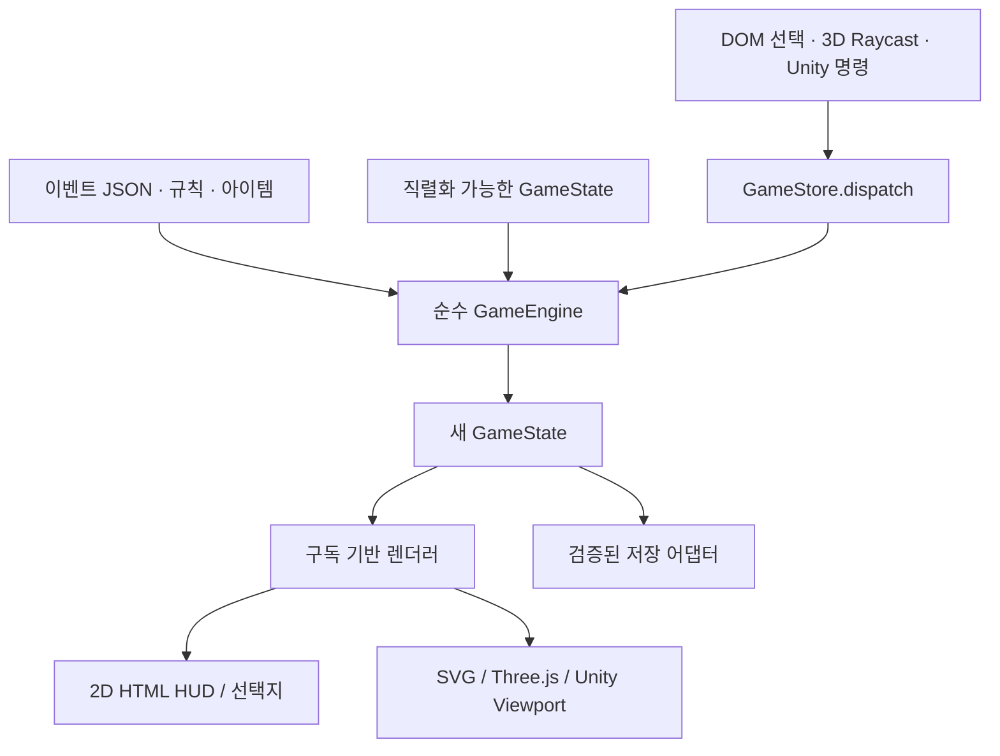
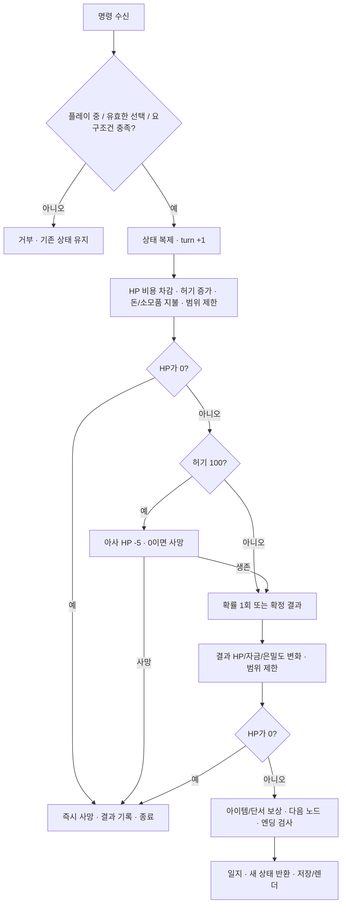

# 시스템 아키텍처와 자원 관리

## 1. 경계와 파일 구조

```text
/data/events.json                   # 규칙값, 아이템, 6장 이벤트 그래프, 3D 장면 레지스트리
/schemas/game-state.schema.json     # 글로벌 상태의 Draft-07 JSON Schema
/schemas/events.schema.json         # 이벤트/세계 데이터의 Draft-07 JSON Schema
/data/initial-state.example.json    # 실제 초기 상태 예제
/src/game-engine.mjs                # 순수 명령 처리, 비용·아사·확률·보상·저장 검증
/src/three/                        # 캐릭터/3D 공간/카메라/입력 어댑터
/assets/civilian.blend              # 편집 가능한 스킨·리그·동작 원본
/assets/civilian.glb                # 번들에 내장하는 캐릭터
/data/spaces.json                  # 12개 3D 공간과 이벤트 연결
/src/ui.mjs                         # DOM 렌더러, 타이핑, 기기 저장, 입력 어댑터
/src/index.template.html            # 오버레이 골격, CSS, 인라인 2D SVG
/scripts/build.mjs                  # 데이터와 소스를 단일 index.html로 조립
/scripts/serve.mjs                  # 정적 페이지와 healthz만 노출하는 서버
/tests                             # 도메인·스키마·브라우저 검증
/index.html                        # 배포 가능한 단일 생성물
```

빌드 시 JSON을 HTML의 `application/json` 블록에 삽입하고 도메인·UI·Three.js 모듈과 GLB 바이너리를 esbuild로 합친다. JSON의 `<`는 `\u003c`로 치환하고 실행 스크립트의 닫는 태그 삽입을 차단한다. 결과물은 `fetch`, import, CDN 없이 실행한다. 유지보수 소스는 분리하고 배포 형식은 단일 파일로 유지하는 방식이다.



서버는 게임 판정을 하지 않는다. 현재 게임은 싱글 플레이이므로 클라이언트 저장을 신뢰하는 범위에서 동작한다. 개발자 도구를 통한 상태 조작 방지는 제공하지 않는다. 향후 경쟁·공유 재화가 생기면 판정 엔진을 서버로 옮기고 인증·서명·동시성 처리를 별도로 설계한다.

## 2. 글로벌 상태 계약

전체 스키마는 [`game-state.schema.json`](../schemas/game-state.schema.json)에 있다. `additionalProperties: false`로 알 수 없는 최상위 필드와 잘못된 자원 타입을 거부한다. 아래는 실제 초기 상태와 같다.

```json
{
  "schemaVersion": 1,
  "runId": "run-45584954",
  "status": "playing",
  "chapterId": "ch1",
  "nodeId": "ch1.home",
  "turn": 0,
  "stats": {
    "hp": 92,
    "maxHp": 100,
    "hunger": 18,
    "maxHunger": 100,
    "dollars": 18,
    "stealth": 76
  },
  "inventory": { "bread": 1, "canned_food": 1, "medkit": 1, "radio": 0, "forged_id": 0 },
  "flags": [],
  "visited": ["ch1.home"],
  "rngState": 1163413844,
  "journal": [],
  "lastResult": null
}
```

`runId`의 헥스 시드와 `rngState`는 같은 초기값으로 시작한다. `turn`은 누적 결정 수이며 AP가 아니다. `visited`는 고유 장면 ID의 목록으로 장별 여정 표시를 만들 때 쓴다. 좌표·DOM 요소·Three.js 객체·Unity GameObject·타이머·Promise는 저장하지 않는다.

| 필드 | 계약 |
|---|---|
| `status` | `playing`, `dead`, `escaped`. HP 0은 `dead`; 엔딩 노드에 살아서 진입하면 `escaped` |
| `stats` | 모든 수치는 정수. HP/허기/은밀도 0~100, 달러 0~1,000,000 |
| `inventory` | 전체 아이템 ID를 키로 포함. 수량 0~999 |
| `flags` | `world.flags`에 선언된 ID의 중복 없는 배열 |
| `rngState` | 32비트 unsigned 정수. 판정 후의 값을 저장 |
| `journal` | 최근 60개. 선택명, 본문, 출발 노드, 결정 번호, 순변화량, 아사 피해, 확률·판정값 |
| `lastResult` | 직전 결과 또는 null. 본문·결과 UI가 이를 읽음 |

스키마가 범위·타입을 검증하고 도메인의 `validateState`가 노드 존재, 노드와 챕터 일치, 아이템 키 집합, 플래그 존재, 방문 목록, 엔딩과 상태 일치 같은 참조 무결성을 검사한다. 스키마만 통과해도 안전한 저장이라는 의미는 아니다.

## 3. 행동의 원자적 처리 순서



1. 선택이 현재 노드에 있고 여정이 진행 중인지 확인한다. 필요한 단서·아이템, 일회성 플래그, 지불할 자금을 검사한다. 실패한 명령은 기존 상태·난수를 바꾸지 않는다.
2. 기존 상태를 깊게 복제한다. HP를 차감하고 허기를 높인다. 거래 비용과 `cost.items`를 지불한다. 아이템 사용은 소지품 하나를 먼저 소비한다.
3. HP를 0~100으로 제한하고 **0이면 바로 중단**한다. 이 경우 사망 뒤 아사 피해를 추가로 기록하지 않는다.
4. 비용 적용 후 허기 100이면 아사 피해 5를 한 번 적용한다. HP 0이면 보상·회복·확률 판정 없이 중단한다.
5. 생존하면 확률값을 계산하고 PRNG를 한 번 진행한다. 확정 선택에서는 PRNG를 소비하지 않는다. 물품 사용은 이 위치에서 회복 효과를 적용한다.
6. 결과 피해로 HP가 0이면 다음 장면·아이템 보상·플래그를 적용하지 않는다. 사망 노드는 출발 장면으로 유지된다.
7. 생존 상태에서만 보상, 다음 노드, 챕터, 방문 기록을 반영한다. 엔딩 노드는 상태를 `escaped`로 바꾼다.
8. 최종 순변화량과 결과를 기록하고 새 상태를 반환한다. 저장·렌더링은 도메인 밖에서 수행한다.

`effects.hunger`는 회복용 0 이하 값으로 제한한다. 허기를 높이는 모든 부담은 `cost.hunger`에 선언해 아사 판정이 뒤늦게 누락되지 않도록 했다. 결과의 HP 회복도 앞선 비용으로 이미 사망한 상태를 되살리지 못한다.

### 상태 불변식

- 음수 자원·소지품은 남지 않는다. 100을 넘는 HP/허기/은밀도는 저장하지 않는다.
- 한 번의 유효 명령은 결정 수를 정확히 1 늘린다. 타이핑·대화상자·저장은 결정 수를 늘리지 않는다.
- 랜덤 결과를 미리 렌더링하면서 난수를 진행하지 않는다. UI는 확률만 계산한다.
- 화면이 바뀌거나 프레임이 렌더링될 때 자원을 차감하지 않는다.
- 아이템 구입과 사용은 서로 다른 비용·명령이다.
- `status !== playing`이면 생존 명령을 거부한다.

## 4. 이벤트 데이터 모델

전체 스키마는 [`events.schema.json`](../schemas/events.schema.json)이다. 세계는 규칙, 챕터, 아이템 사전, 플래그 라벨, 3D 장면 레지스트리와 노드 그래프로 이루어진다.

노드는 `id`, `chapterId`, `title`, `text`, `scene_3d`, `camera_mode`, `choices`를 가진다. 선택지는 `id`, `label`, `description`, `cost`가 필수다. 확정 선택은 `outcome`, 확률 선택은 `chance`+`success`+`failure`만 가지며 두 형식을 혼합할 수 없다. `requires.allFlags`, `missingFlags`, `items`는 가용성을 제한한다. `requires.items`는 보유 검사, `cost.items`는 실제 소모라서 역할이 다르다.

결과는 `text`, `target`, 선택적인 `effects`, `addItems`, `addFlags`로 선언한다. 코드에 `if (chapter === 3)` 같은 게임 규칙을 넣지 않는다. 소비 아이템과 단서는 `kind`로 구별하며 후자는 사용 명령이 거부된다. 3D 이동은 `TRAVEL` 명령으로 같은 비용·아사 경로를 사용한다. 자세한 거리 선결제와 좌표의 체크포인트 복원은 [THIRD-PERSON.md](THIRD-PERSON.md)를 참고한다. 새 효과 연산자를 추가하려면 먼저 스키마와 엔진·검증을 확장한 다음 데이터에서 사용한다. JSON에 임의 JavaScript나 eval 식을 넣지 않는다.

빌드는 `assertValidWorld`로 그래프의 중복 ID·끊긴 대상·알 수 없는 단서·아이템 참조를 검사한다. 테스트에서 Ajv의 strict 모드로 전체 스키마를 검사하고 시작점으로부터 모든 14개 노드가 도달 가능한지 확인한다.

## 5. 컴포넌트와 렌더러 교체

```text
GameHost (GameStore + 저장/입력 어댑터)
├─ JourneyRail
├─ Header (규칙 / 기록 / 새 여정)
├─ StatsHUD (HP / Hunger / Dollars / Stealth)
└─ ContentGrid
   ├─ NarrativeColumn
   │  ├─ SceneFrame (position: relative; isolation: isolate)
   │  │  ├─ ViewportLayer [absolute; inset: 0; z-index: 0]
   │  │  │  └─ SvgRenderer → ThreeCanvas / UnityCanvas
   │  │  ├─ Vignette + Grain [z-index: 1~2; pointer-events: none]
   │  │  └─ SceneUIOverlay [z-index: 3; 본문 / 장면 정보 / 생략 버튼]
   │  ├─ LatestResult
   │  └─ ChoicePanel (항상 HTML · 3D에서도 접근 가능한 상호작용)
   └─ SideColumn (Inventory / Objective / Clues)
```

`GameStore.getSnapshot()`은 깊은 복사본을 반환한다. 렌더러는 `subscribe(callback)`을 통해 상태를 읽고 `dispatch(command)`로 명령을 보낸다. 외부 렌더러용 `window.ExitNorthBridge`는 같은 인터페이스와 `getScene()`을 제공한다.

```js
// DOM 클릭, Three.js의 raycast, Unity 콜백이 같은 명령을 사용한다.
ExitNorthBridge.dispatch({ type: 'CHOOSE', choiceId: 'sneak' });
ExitNorthBridge.dispatch({ type: 'USE_ITEM', itemId: 'bread' });
const unsubscribe = ExitNorthBridge.subscribe(snapshot => renderer.render(snapshot));
const metadata = ExitNorthBridge.getScene();
// { nodeId, scene_3d, camera_mode, environment, assetKey, spawn, lighting, hotspots }
```

`dispatch`는 UI 경계에서 `{ok, state}` 또는 `{ok:false, error}`를 반환한다. 엔진 함수와 `createGameStore.dispatch` 자체는 잘못된 명령에서 예외를 던지므로 테스트와 서버 이식에서 오류를 구분할 수 있다. 현재 엔진을 유지한 React 전환도 가능하다. `useSyncExternalStore` 또는 동등한 구독 어댑터로 스냅샷을 읽고 위 컴포넌트를 함수 컴포넌트로 나누면 된다.

## 6. 저장·재현성·보안 경계

저장 키는 `exit-north.save.v1`이며 다음 봉투로 저장한다.

```json
{ "schemaVersion": 1, "dataRevision": "2026-10-30.1", "state": {} }
```

위 `{}`는 형식 설명용 자리이며 실제 저장에는 전체 글로벌 상태가 들어간다. 데이터 버전이 다르거나 상태가 손상되면 기존 상태를 적용하지 않고 새 여정을 만들며 알림을 표시한다. 저장 거부·할당량 초과는 현재 탭의 플레이를 막지 않는다. 별도 마이그레이션을 구현하기 전까지는 호환성 변경 시 새 여정이 필요하다.

PRNG는 Mulberry32이며 `rngState`를 직렬화한다. 암호학적 난수가 아니고 공정성이 필요한 베팅·경쟁 서비스용도 아니다. 시작 시드는 `crypto.getRandomValues`를 사용하고, 재현 테스트는 고정 시드를 주입한다. 같은 상태·명령·세계 데이터는 같은 결과를 낸다.

JSON Schema는 스키마 패키지가 있는 테스트 환경에서 검사한다. 단일 파일 런타임에는 의존성을 넣지 않고 별도의 `validateState`로 복원 상태를 검증한다. DOM 동적 텍스트는 이스케이프하거나 `textContent`로 넣는다. 네트워크 호출·분석 추적·개인정보 수집은 없다. 서버는 경로를 허용 목록으로 제한해 `.git`, 소스, 임의 파일을 노출하지 않는다.

현재 호스트의 CSP는 단일 인라인 실행물을 위한 정책이다. 실제 외부 Three.js/Unity 로더·모델·WASM을 도입할 때는 [3D 가이드](3D-EXTENSION.md)의 출처·worker·WASM 정책과 함께 조정해야 한다.
